<div align="center" style="padding: 10%;">


# Multiproductos Mascotas

## Tótem de autopedido para una tienda de productos para mascotas

<p>
  
  
  
  
</p>

<p>
  
  
  
  
</p>

</div>


## Descripción

App nativa de Android diseñada como tótem de autopedido. La app muestra el catálogo de la tienda organizado en tres niveles (categoría principal, subcategoría y producto), permite agregar productos al carrito con control de stock y finalizar la compra con pago con tarjeta o en efectivo.

Está pensada para un tótem:

- Pantalla completa con modo inmersivo (se ocultan las barras del sistema).
- Mensajes de confirmación y error visibles sobre la pantalla actual.
- Regreso automático al inicio tras 60 segundos sin interacción, con vaciado del carrito para el siguiente cliente.

## Características

|Característica | Descripción |
|---|---|
|**Catálogo por categorías** | Categoría principal → subcategoría → productos, cargados desde Firebase Realtime Database. |
|**Control de stock** | Solo se muestran productos con stock disponible y el detalle valida la cantidad antes de agregar. |
|**Detalle de producto** | Imagen, descripción, precio, marca y selector de cantidad. |
|**Carrito persistente** | Se guarda en el dispositivo (SharedPreferences), con aumento, disminución y eliminación de ítems y cálculo del total con impuesto. |
|**Pago con tarjeta** | Hoja de pago de Stripe (PaymentSheet) para tarjetas. |
|**Pago en efectivo** | Pantalla de caja con factura, que descuenta el stock al confirmar. |
|**Datos del cliente** | Formularios de cédula, nombre, dirección, teléfono y correo antes del pago. |
|**Feedback en pantalla** | Mensajes de éxito (se ocultan solos) y de error (se quedan hasta que el cliente los toca). |
|**Inactividad** | Vuelve al inicio y vacía el carrito tras 60 segundos sin tocar la pantalla. El flujo de pago está excluido de este regreso automático. |

> Las credenciales y la configuración privada no están incluidas en este repositorio; ver [Configuración](#configuración).

## Arquitectura

Las pantallas heredan de `BaseActivity`, que centraliza el feedback, la inactividad y el modo inmersivo. La lógica del carrito vive en `ManagmentCart`, que persiste los datos con `TinyDB`. Firebase y Stripe son los servicios externos.

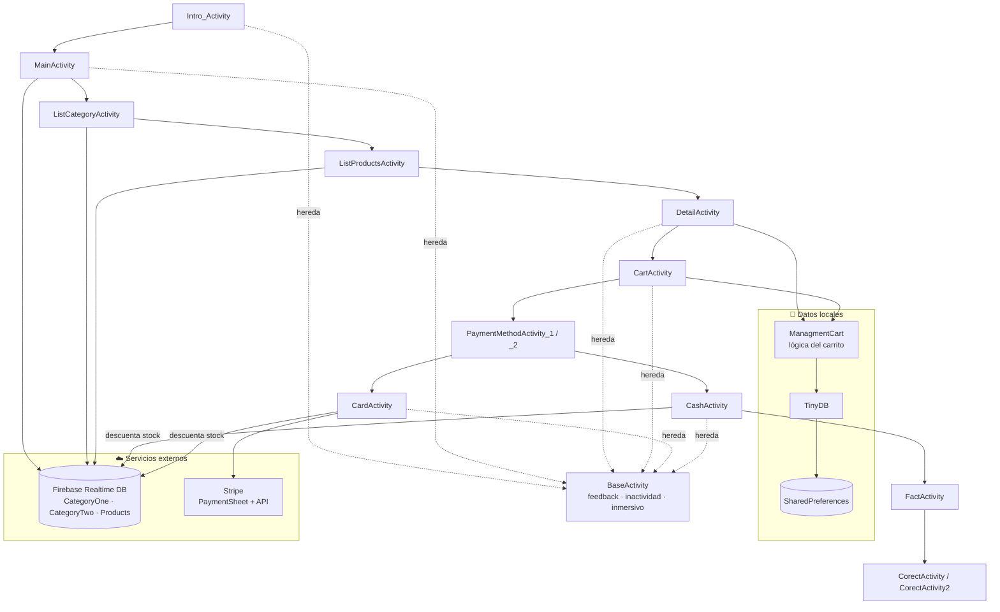

**Nodos centrales:**

| Clase | Rol |
|---|---|
| `Product` | Modelo de producto, usado por casi todas las pantallas y adaptadores. |
| `TinyDB` | Persistencia local sobre SharedPreferences. |
| `ManagmentCart` | Reglas del carrito: agregar, quitar, cantidades y total. |
| `BaseActivity` | Base de todas las pantallas: feedback, inactividad y modo inmersivo. |

## Estructura del proyecto

```text
app-empre/
├── 📁 app/
│   ├── 📄 build.gradle
│   ├── 📄 google-services.json          # NO incluido (ver Configuración)
│   └── 📁 src/
│       ├── 📁 main/
│       │   ├── 📄 AndroidManifest.xml
│       │   ├── 📁 java/com/emprendimiento/multiproductosmascotas/
│       │   │   ├── 📁 Activity/         # Pantallas (una actividad por pantalla)
│       │   │   ├── 📁 Adapter/          # Adaptadores de RecyclerView
│       │   │   ├── 📁 Domain/           # Modelos: Product, CategoryOne, CategoryTwo
│       │   │   └── 📁 Helper/           # ManagmentCart, TinyDB, ChangeNumberItemsListener
│       │   └── 📁 res/                  # Layouts, drawables, colores, temas, strings
│       ├── 📁 test/                     # Pruebas unitarias
│       └── 📁 androidTest/              # Pruebas instrumentadas
├── 📁 database/
│   └── 📄 ProductosMascotas-placeholders.json  # Esquema bd
├── 📁 docs/
│   └── 📁 screenshots/                  # Capturas de la app
├── 📁 gradle/
│   └── 📄 libs.versions.toml            # Catálogo de versiones
├── 📄 build.gradle
├── 📄 settings.gradle
├── 📄 gradle.properties
└── 📄 README.md
```


## Modelo de datos

Para crear o actualizar la estructura de Firebase Realtime Database, usa como guía el archivo [`database/ProductosMascotas-placeholders.json`](database/ProductosMascotas-placeholders.json). El resumen siguiente solo muestra los nodos y campos principales:

| Nodo | Campos principales |
|---|---|
| `CategoryOne` | `Id`, `Name` |
| `CategoryTwo` | `Id`, `Name`, `CategoryOneId` |
| `Products` | `Id`, `CategoryOneId`, `CategoryTwoId`, `Title`, `Description`, `Price`, `Stock`, `ImagePath`, `Mark`, `BestProduct` |

El `Id` de cada producto coincide con su clave en `Products`, porque el pago descuenta el stock buscando `Products/{Id}`.

Las reglas de Realtime Database necesitan índices para las consultas por categoría:

```json
{
  "rules": {
    "CategoryTwo": { ".indexOn": ["CategoryOneId"] },
    "Products": { ".indexOn": ["CategoryTwoId"] }
  }
}
```

## Stack tecnológico

| Categoría | Tecnología |
|---|---|
| IDE | Android Studio |
| Lenguaje |  Java 8 |
| Plataforma |  Android (minSdk 24, targetSdk 34) |
| Build |  Gradle (wrapper 9.7.1), Android Gradle Plugin 8.5.0 |
| UI | XML, ViewBinding, Material Components, ConstraintLayout, RecyclerView |
| Imágenes | [Glide](https://github.com/bumptech/glide) 4.12.0 |
| Red | [Volley](https://developer.android.com/training/volley) 1.2.1 |
| Backend |  Firebase Realtime Database (Firebase Auth inicializado, sin flujo de login) |
| Pagos |  Stripe Android SDK 17.2.0 (PaymentSheet) |
| Persistencia local | SharedPreferences (TinyDB), Gson 2.9.1 |
| Pruebas | JUnit 4, AndroidX Test, Espresso |


## Requisitos

**Requisitos previos:**

- Android Studio Iguana o superior.
- JDK 17 para ejecutar Gradle.
- Un dispositivo o emulador con Android 7.0 (API 24) o superior.
- Un proyecto de Firebase con Realtime Database y Authentication habilitados.
- Una cuenta de Stripe en modo de pruebas.


## Configuración

1. **Clona el repositorio** y ábrelo en Android Studio.

2. **Agrega tu `google-services.json`**. Descárgalo desde la consola de Firebase (configuración del proyecto → tu app Android) y colócalo en `app/google-services.json`. Este archivo no se incluye en el repositorio.

3. **Configura las claves de Stripe**. El repositorio no incluye claves. En `app/src/main/java/com/emprendimiento/multiproductosmascotas/Activity/CardActivity.java` reemplaza los valores de `SECRET_KEY` y `PUBLISH_KEY` por tus claves de prueba.

   > Este enfoque solo sirve para pruebas. La clave secreta no debe estar en la app.

4. **Carga los datos de ejemplo**. En la consola de Firebase, ve a *Realtime Database → Datos → ⋮ → Importar JSON* y elige [`database/ProductosMascotas-placeholders.json`](database/ProductosMascotas-placeholders.json).

## Screenshots

<div align="center">

| Inicio | Catálogo | Subcatálogo |
|:---:|:---:|:---:|
| 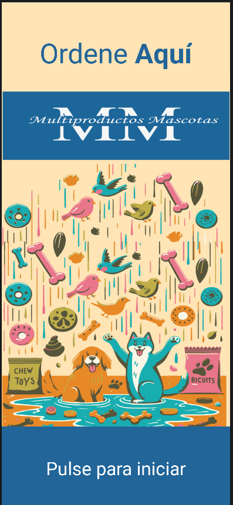 | 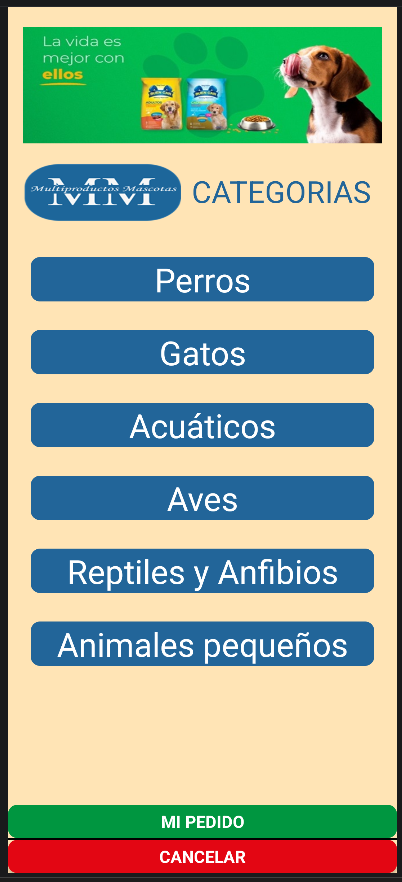 | 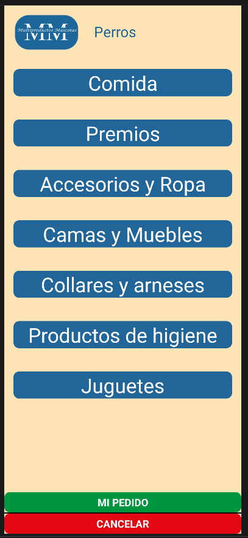 |

| Subcatalogo | Detalle | Carrito |
|:---:|:---:|:---:|
| 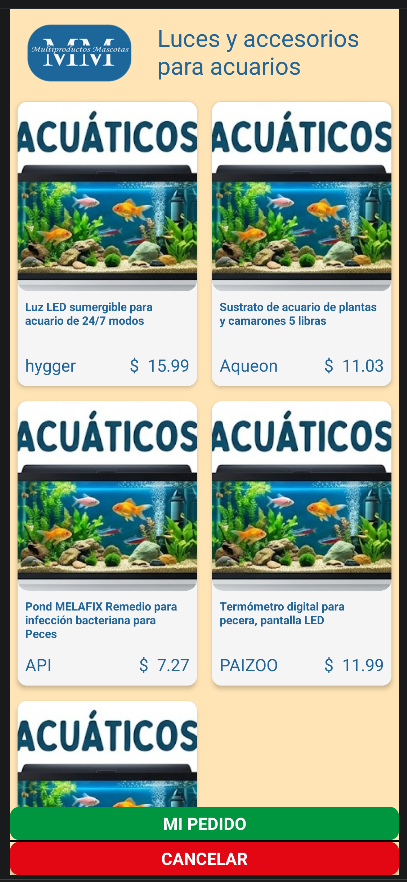 | 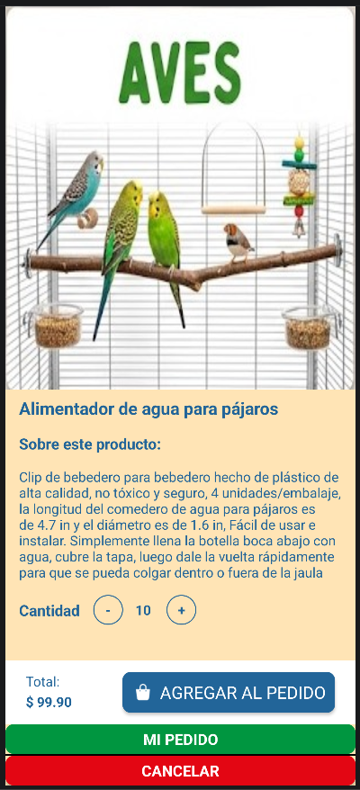 | 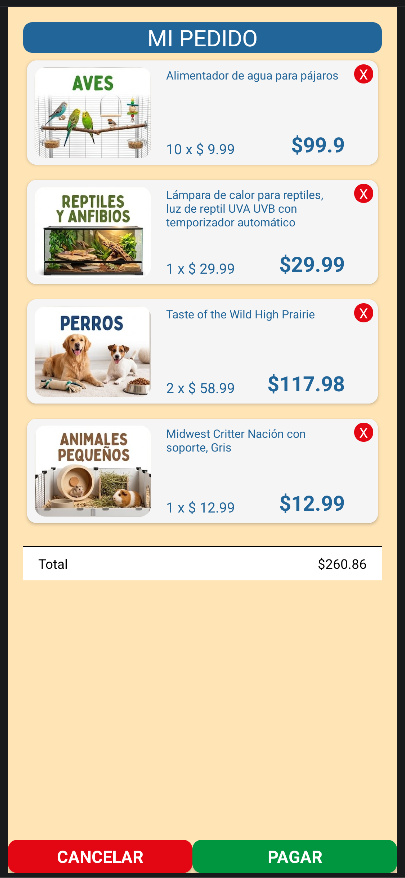 |

| Pago | Caja | Tarjeta |
|:---:|:---:|:---:|
| 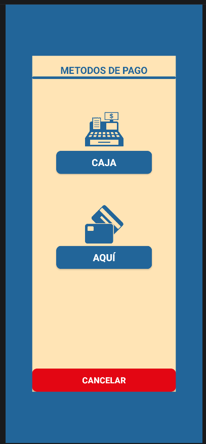 | 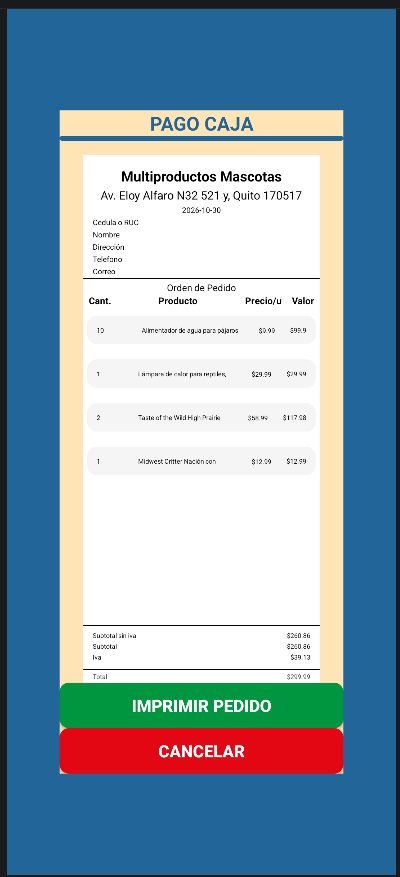 | 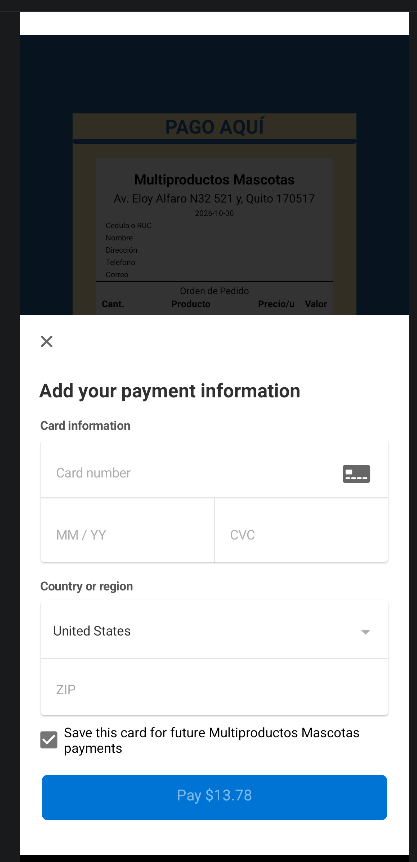 |

| Mensaje final |
|:---:|
| 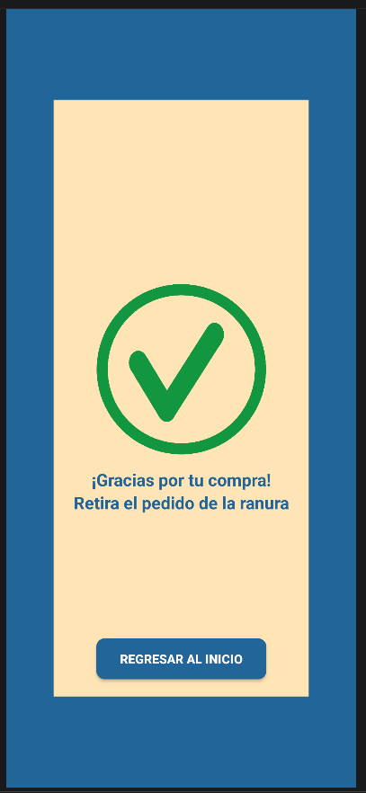 |

</div>


## Información general

- **Nombre de la aplicación:** Multiproductos Mascotas · **Paquete:** `com.emprendimiento.multiproductosmascotas` · **Versión:** `1.0`
- **UI language:** Español
- **Estado:** en desarrollo.
- **Nota de seguridad:** Este es un proyecto demostrativo. Antes de usarlo con cobros reales, implementa el backend de pagos.

---

<div align="center">

Creado con Android Studio y Java por **Pablo Simbaña**

</div>
